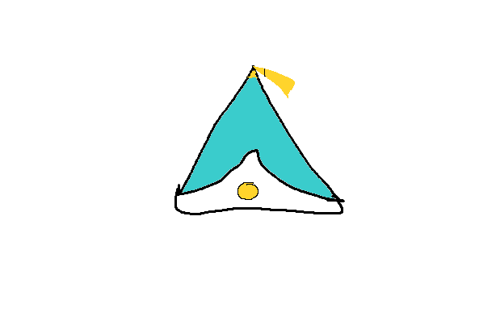

<div align="center">

  <h1>Coco Chess Engine</h1>

  

  <br>
  <br>

  [![Latest release][release-badge]][release-link]
  [![License: GPL v3][license-badge]][license-link]
  [![C++20][cpp-badge]][source-link]

  [Official website](https://notkaede-11.github.io/coco-engine-website/) · [Download][release-link] · [Quick start](#quick-start) · [Build](#build-from-source) · [Changelog](CHANGELOG.md)

</div>

---

Coco is a free, open-source C++20 chess engine for UCI-compatible GUIs. It is named after Coco from *Witch Hat Atelier*.

The features and UCI options below describe **Coco 2.0**. See the
[changelog](CHANGELOG.md) for changes and local match results.

## Strength

| Version | My Estimate | CCRL 40/15 | CCRL Blitz | Chess Engines Diary (CEDR) |
| :---: | :---: | :---: | :---: | :---: |
| 2.0.0 | 3550 | | | |
| 1.5.1 | 2977 | - | [2986](https://computerchess.org.uk/404/cgi/engine_details.cgi?print=Details&each_game=1&eng=Coco%201.5.1%2064-bit#Coco_1_5_1_64-bit) | [3165][cedr-october-2026] |
| 1.5.0 | 2977 | [3027](https://computerchess.org.uk/4040/cgi/engine_details.cgi?print=Details&each_game=0&eng=Coco%201.5.0%2064-bit#Coco_1_5_0_64-bit) | - | - |
| 1.4.0 | - | - | - | - |
| 1.3.0 | - | - | - | - |
| 1.1.1 | - | - | [2596](https://computerchess.org.uk/404/cgi/engine_details.cgi?print=Details&each_game=1&eng=Coco%201.1.1%2064-bit#Coco_1_1_1_64-bit) | - |
| 1.1.0 | - | - | - | - |
| 1.0.1 | - | - | - | - |
| 1.0.0 | - | - | - | - |

## Quick start

1. Download a published binary for your platform from the [releases page][release-link].
2. Choose the binary that best matches your CPU using the table below.
3. Add the executable as a UCI engine in your chess GUI.

To check the engine directly from a terminal, start it and enter:

```text
uci
isready
position startpos
go movetime 1000
```

Wait for `bestmove`, then enter `quit`.

## Choose the right binary

See the [release downloads][release-link] for available builds.

| Platform | Build | Best fit |
|:--|:--|:--|
| Windows / Linux | `x86-64-bmi2` | Modern Intel and AMD Zen 3 or newer; recommended for most recent x86 systems |
| Windows / Linux | `x86-64-avx2` | AMD Zen 1/2 or systems where BMI2 `pext` is relatively slow |
| Windows / Linux | `x86-64-avx512` | CPUs with AVX-512F, BW, DQ, and VL support |
| Windows / Linux | `x86-64-popcnt` | Older 64-bit x86 CPUs with SSE4.1 and POPCNT |
| macOS | `apple-silicon` | Apple M-series processors |
| macOS | `x86-64-avx2` / `x86-64-popcnt` | Intel-based Macs |
| Linux ARM | `arm64` / `arm64-dotprod` | ARMv8 systems, with dot-product build for supported ARMv8.2+ CPUs |

Using instructions unsupported by your CPU will prevent the engine from starting. When uncertain, choose the POPCNT or baseline ARM64 build.

## Features

| Component | Architecture & Highlights |
|:--|:--|
| **Variants** | Standard chess and Chess960 (Fischer Random) via `UCI_Chess960` |
| **Move Generation** | 64-bit bitboards with magic or BMI2/PEXT sliding attacks |
| **Search** | Iterative deepening with alpha-beta/PVS, aspiration windows, and late-move reductions |
| **Neural Evaluation** | Embedded Ravager v3 NNUE with incremental accumulator updates. The executable runs without a separate network file. |
| **Concurrency** | Lazy SMP with a shared transposition table |
| **Analysis & Endgames** | MultiPV, pondering, and Syzygy tablebase probing |

## UCI configuration

The 2.0 development build exposes ten options to chess GUIs. To play Chess960, enable the variant in a Chess960-capable GUI and load a Chess960 starting position.

| Option | Default | Purpose |
|:--|--:|:--|
| `Hash` | 16 MiB | Transposition-table memory |
| `Clear Hash` | button | Clear the transposition table |
| `Threads` | 1 | Parallel search workers |
| `Ponder` | false | Think during the opponent's turn |
| `MultiPV` | 1 | Number of principal variations to report |
| `Move Overhead` | 30 ms | Safety allowance for GUI and operating-system latency |
| `SyzygyPath` | empty | Path to Syzygy tablebase files |
| `SyzygyProbeDepth` | 1 | Minimum search depth for probing positions at the largest loaded tablebase size |
| `Syzygy50MoveRule` | true | Respect the 50-move rule in root tablebase decisions |
| `UCI_Chess960` | false | Enable Chess960 castling rules and UCI move encoding |

## Build from source

Building 2.0 requires a C++20 compiler, a C11 compiler, and Python 3.11 or newer.
Run the commands below from the repository root after downloading or cloning
the complete source, including `networks/` and `third_party/`.

The build verifies and embeds `networks/coco.nnue`. This is the original
Ravager v3 network under Coco's packaging filename. Its bytes and SHA-256 are
recorded in `release.json` and the [third-party notices](third_party/NOTICES.md).
The finished executable includes the network.

### Windows

With GCC/MinGW (`gcc` and `g++`) available on `PATH`:

```cmd
python scripts/build_release.py --arch native --jobs 2 --output coco-chess.exe
```

### Makefile builds

```bash
make build ARCH=x86-64-popcnt COMP=gcc
make build ARCH=x86-64-avx2   COMP=gcc
make build ARCH=x86-64-bmi2   COMP=gcc
make build ARCH=x86-64-avx512 COMP=gcc
make build ARCH=armv8         COMP=gcc
make build ARCH=armv8-dotprod COMP=gcc
make build ARCH=apple-silicon COMP=clang
```

Use `COMP=mingw` to cross-compile Windows binaries from Linux. Run `make help` for all supported targets and options.

`release.json` records the version, selected network hash, expected search
signature and package names. The build and CI read it to verify the release inputs.

## License

Coco's original code is licensed under [GPLv3][license-link]. The 2.0 build includes AGPLv3-licensed Ravager evaluator code by erensh27 and CC0 1.0 Ravager v3 weights. See the [third-party notices](third_party/NOTICES.md) for attribution and redistribution details.

[release-badge]: https://img.shields.io/github/v/release/NotKaede-11/Coco-Engine?style=flat-square
[release-link]: https://github.com/NotKaede-11/Coco-Engine/releases/latest
[license-badge]: https://img.shields.io/github/license/NotKaede-11/Coco-Engine?style=flat-square&label=license
[license-link]: LICENSE
[cpp-badge]: https://img.shields.io/badge/C%2B%2B-20-00599C?style=flat-square&logo=cplusplus
[source-link]: src
[cedr-october-2026]: https://chessengines.blogspot.com/2026/10/the-102026-season-of-chess-engine.html?m=0
